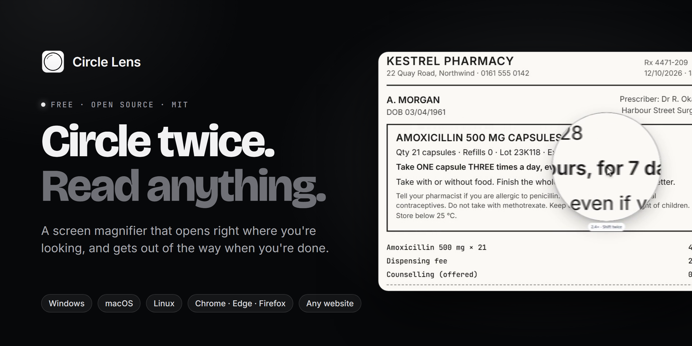
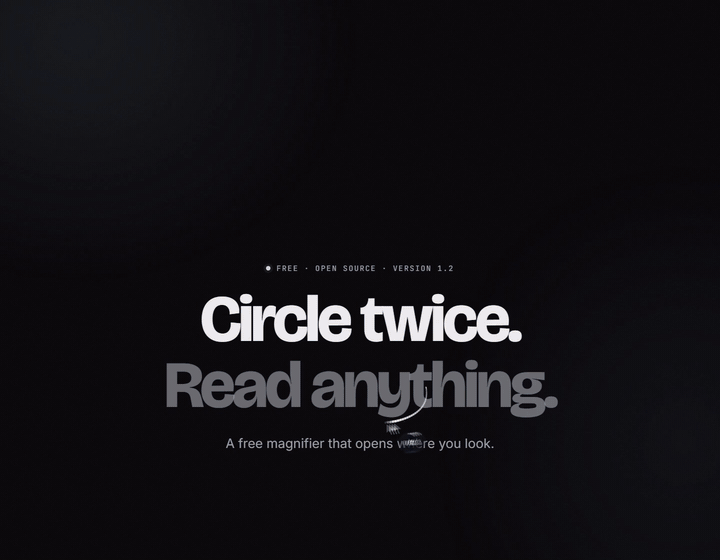
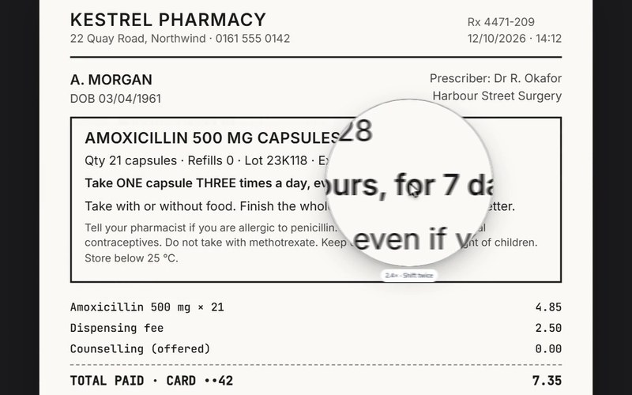
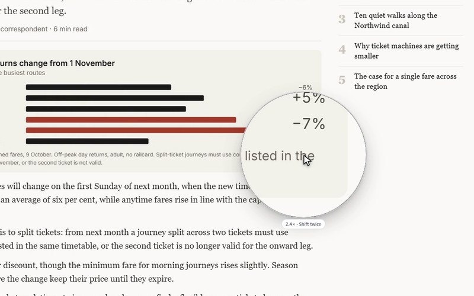
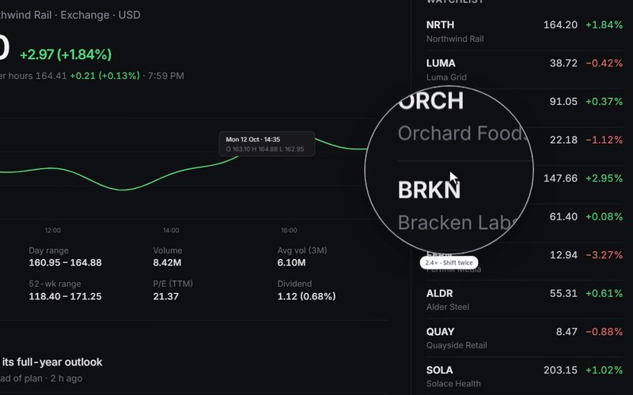
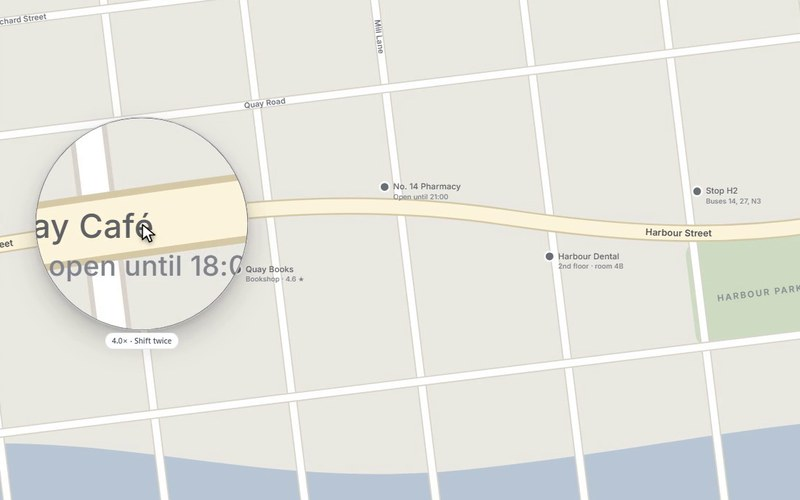
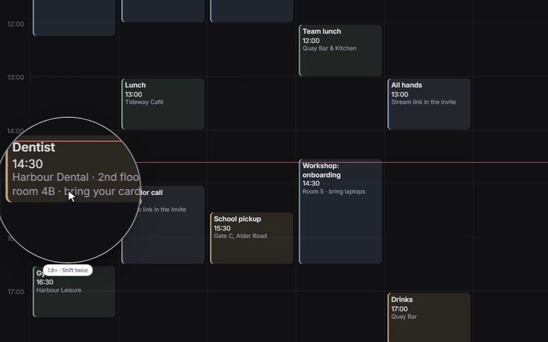

<p align="center">
  <a href="https://fauzul.com/circle-lens"></a>
</p>

<p align="center">
  <b>A free screen magnifier that opens where you're looking.</b><br>
  Draw a circle twice with the mouse, or tap <kbd>Shift</kbd> twice, and a round magnifying glass opens at the pointer and follows it.<br>
  For Windows, for your browser, and for your own website.
</p>

<p align="center">
  <a href="https://github.com/fauzulkc/circle-lens/releases/latest"></a>
  <a href="https://github.com/fauzulkc/circle-lens/releases"></a>
  <a href="https://github.com/fauzulkc/circle-lens/actions/workflows/ci.yml"></a>
  <a href="https://www.npmjs.com/package/circle-lens"></a>
  <a href="LICENSE"></a>
</p>

<p align="center">
  <a href="https://github.com/fauzulkc/circle-lens/releases/latest/download/CircleLens-Setup.exe"></a>
  <a href="#in-your-browser"></a>
  <a href="#add-it-to-your-website"></a>
  <a href="#macos-and-linux-preview"></a>
</p>

<p align="center">
  
</p>

<p align="center"><sub>The real lens, recorded frame by frame. Nothing here is mocked up.</sub></p>

## Why Circle Lens

Zooming the whole screen fixes one line and breaks every other window. Circle Lens zooms only the line you're reading, right where you're reading it, and then gets out of the way.

<table>
  <tr>
    <td width="33%" valign="top"><b>Opens where you're looking</b><br>No zoom settings to find. Circle twice, or tap <kbd>Shift</kbd> twice, and the lens is already at the pointer.</td>
    <td width="33%" valign="top"><b>Follows you, then steps aside</b><br>It moves with the mouse. Move fast and it eases its zoom out so you can see where you're going, then back in as you slow down.</td>
    <td width="33%" valign="top"><b>Zooms only what you read</b><br>The rest of the screen stays as it was: no lost windows, no panning around a giant desktop.</td>
  </tr>
  <tr>
    <td valign="top"><b>Light enough to forget</b><br>A 2.7 MB app with no dependencies. 13 MB of memory while it waits, and no CPU at all while the mouse is still.</td>
    <td valign="top"><b>Smooth as the screen</b><br>Drawn at your display's refresh rate: 68 frames for the 560 ms spring open on a 120 Hz screen.</td>
    <td valign="top"><b>Yours, not ours</b><br>No account, no ads, no tracking. It never logs keys, and it's open source under the MIT license.</td>
  </tr>
</table>

## Read anything

<table>
  <tr>
    <td width="33%" valign="top"><br><b>Labels and receipts.</b> The dose, the date, the total.</td>
    <td width="33%" valign="top"><br><b>The news.</b> Chart labels and the fine print under them.</td>
    <td width="33%" valign="top"><br><b>Dashboards.</b> Small numbers, made big.</td>
  </tr>
  <tr>
    <td valign="top"><br><b>Diagrams.</b> Read the labels without leaning in.</td>
    <td valign="top"><br><b>Maps.</b> Street names and opening hours.</td>
    <td valign="top"><br><b>Calendars.</b> What's at 14:30, and where.</td>
  </tr>
</table>

<a id="just-want-a-magnifier-for-your-computer"></a>

## Get it

| | **Windows app** | **Browser extension** | **Your website** |
|---|---|---|---|
| **Works in** | every app on the screen | any web page in Chrome, Edge or Firefox | your site, for every visitor |
| **Get it** | [CircleLens-Setup.exe](https://github.com/fauzulkc/circle-lens/releases/latest/download/CircleLens-Setup.exe) | [circle-lens-extension.zip](https://github.com/fauzulkc/circle-lens/releases/latest/download/circle-lens-extension.zip) | one `<script>` tag, or `npm install circle-lens` |
| **Size** | 2.7 MB, no dependencies | 19 KB | 7 KB gzipped |
| **Updates** | itself, once a day (you can turn it off) | with each new zip | when you bump the version |

On a **Mac or Linux**, there's a [preview of the app](#macos-and-linux-preview) to try. Your system also has a magnifier built in; [llms.txt](llms.txt) says where to find it.

### On Windows

On **Windows 10 or 11**:
1. [Download **CircleLens-Setup.exe**](https://github.com/fauzulkc/circle-lens/releases/latest/download/CircleLens-Setup.exe), the newest version, and open it.
2. If your browser or Windows warns you about it, that's because the app is new and isn't signed yet. [Here's how to get past each warning](#windows-or-your-browser-warns-you).
3. Click **Install Circle Lens**. It needs no administrator password, and you choose whether it starts with Windows and updates itself.
4. Draw a circle twice with the mouse, or tap **Shift** twice, and the lens opens. Ctrl + `+`/`−` zooms. Do the same again to close it.

Its settings are behind the lens icon (a small ring) next to the clock. To remove it: Settings → Apps → Circle Lens → Uninstall.

<p align="center">
  
</p>

**Left click** the tray icon for a compact settings panel: circles, zoom, size, the wait between open and close, your own shortcut, the keys that work while the lens is open, and switches for zooming out when moving fast, the convex rim, starting with Windows and updating automatically. **Right click** has the same settings as a native menu that screen readers can read. Everything about the app, from its command line to how updates are checked, is in **[docs/desktop.md](docs/desktop.md)**.

<a id="use-it"></a>

### In your browser

The extension works in Chrome and Edge on every desktop system, and in Firefox, on web pages. It isn't in the Chrome Web Store yet, so installing it takes a few steps:

1. Download [**circle-lens-extension.zip**](https://github.com/fauzulkc/circle-lens/releases/latest/download/circle-lens-extension.zip) and unzip it into a folder you'll keep.
2. Open `chrome://extensions` (in Edge, `edge://extensions`) and turn on **Developer mode**.
3. Click **Load unpacked** and choose the unzipped folder.
4. Draw a circle twice on any web page, or press **Alt+Shift+L**.

The toolbar button and `Alt+Shift+L` also open and close the lens. Its options page sets the circles needed, starting zoom, lens size, the wait between open and close, and zooming out when moving fast. To change `Alt+Shift+L`, use `chrome://extensions/shortcuts` (in Firefox: Add-ons → ⚙ → Manage Extension Shortcuts). In Firefox, load it from `about:debugging` → This Firefox → Load Temporary Add-on → `manifest.json`; Firefox keeps unsigned extensions only until it restarts.

To build it yourself: `npm install`, then `npm run build:extension`, and load `browser-extension/dist`.

## macOS and Linux (preview)

Early, unsigned builds of the desktop app. They do what the Windows app does (draw a circle twice, or tap Shift twice), with a menu-bar or tray menu for the settings, but they don't update themselves yet. Get them from the newest **[pre-release](https://github.com/fauzulkc/circle-lens/releases)** named "for macOS and Linux (preview)", and [tell us how it goes](https://github.com/fauzulkc/circle-lens/issues).

**macOS 14 Sonoma or later** (Apple silicon or Intel): `CircleLens-<version>-mac.zip`
1. Unzip it and move **Circle Lens** to Applications, then open it.
2. macOS says it can't check the app for malicious software, because it isn't notarized yet. Click **Done**, then go to System Settings → Privacy & Security, scroll down and click **Open Anyway** next to Circle Lens.
3. The first time the lens opens, allow **Screen & System Audio Recording** for Circle Lens (it needs to see the screen to magnify it). For the Shift-twice shortcut, also allow **Input Monitoring**; drawing circles needs nothing.
4. Its settings are in the menu bar (the ring icon), including **Start at login**.

After each update of a preview, macOS asks for those permissions again: an unsigned app looks new to it every time.

**Linux, in an X11 session** (x86_64 or ARM): `CircleLens-<version>-linux-x86_64.tar.gz` or `-aarch64.tar.gz`
1. Unpack it and run `./circle-lens -install`: it copies itself to `~/.local/bin`, adds itself to the app menu and to start-up, and starts.
2. Its settings are in the tray: KDE, Xfce, Cinnamon, MATE and Budgie show it, and GNOME does with the AppIndicator extension (Ubuntu has it on).
3. `circle-lens -quit` stops it; `circle-lens -uninstall` removes it.

The lens is live, with or without a compositor (without one, its edge is hard rather than soft). **Wayland** sessions aren't supported yet: GNOME will get an extension, and KDE and wlroots desktops a version of their own.

## Add it to your website

The `web/` package puts the lens on your own site, for every visitor, with no extension needed. Paste one line into any page:

```html
<script src="https://cdn.jsdelivr.net/npm/circle-lens@0.5.0/dist/circle-lens.min.js" defer></script>
```

Or install it from npm:

```bash
npm install circle-lens
```

```js
import { circleLens } from 'circle-lens';

const lens = circleLens({ zoom: 2 });
```

A web page can't screenshot itself without asking to share the screen. So instead of a screenshot, the lens shows a live copy of the page, as BoundStretch's lens does: the page's own CSS styles it, so text stays sharp at every zoom. The copy follows scrolling, sticky and fixed elements, nested scroll boxes, form values and canvases. [web/README.md](web/README.md) has the options, the API and the limits; `web/demo/index.html` is a page to try it on after `npm run build:web`.

## Set it up with an AI assistant

Ask ChatGPT, Claude, Gemini or Copilot:

> Help me install Circle Lens, a screen magnifier, on my computer. Follow https://raw.githubusercontent.com/fauzulkc/circle-lens/main/llms.txt

To add it to a website, give your coding agent (Claude Code, Cursor, Copilot, Codex…):

> Add Circle Lens to this project. Follow https://raw.githubusercontent.com/fauzulkc/circle-lens/main/web/AI_INSTRUCTIONS.md

<a id="how-lean-the-desktop-app-is"></a>

## How it works

This is the reading lens from BoundStretch, taken out on its own in three forms that share one gesture and one motion: the glass springs open from 55% while it fades in and unblurs, zoom steps glide, and closing reverses it.

- **The gesture** counts how far the pointer path turns, and fires when the last turn closes on itself, is round, and is at least 64 px across. Sharp reversals, pauses over 250 ms and slow drawing start it over, so everyday mousing doesn't count. Against simulated hand-drawn circles and ordinary use, it recognises **99.8–100%** of circles with **no accidental opens** at the default two circles.
- **The desktop app** draws the lens in software into one window that Windows leaves out of screen captures, so there's no GPU stack to load. Frames follow the display's refresh, the capture runs on its own thread, and nothing is captured or redrawn when nothing moved.
- **The website script** never screenshots: it shows a live copy of the page, so text stays sharp at every zoom.

| Desktop app, measured on Windows 11 (4K, 120 Hz) | Memory | CPU |
|---|---|---|
| Idle, watching for circles | 13 MB | none while the mouse is still |
| Lens open | about 37 MB | only when something changes, about 4 ms a frame while moving |
| After closing | under 1 MB working set | capture threads stopped |

The gesture's rules, the measurements, each platform's backend, the code layout and the known limits are in **[docs/how-it-works.md](docs/how-it-works.md)**.

## Questions

### Windows or your browser warns you?

Circle Lens is new and isn't code-signed yet, so Windows and browsers haven't seen enough of it to vouch for it. These warnings mean "unfamiliar", not "harmful":

- **Edge: "CircleLens-Setup-….exe isn't commonly downloaded".** In the downloads list, point at the file and click **…** (More actions), then **Keep**. In the "Make sure you trust…" box, click the arrow next to **Delete**, then **Keep anyway**.
- **Chrome: "isn't commonly downloaded" or "unverified download".** Open the downloads list (the arrow icon at the top right), click the file's warning, then **Keep** or **Download anyway**.
- **Windows: "Windows protected your PC"** (a blue box when you open it). Click **More info**, then **Run anyway**.

If it says **"Virus detected"** instead, don't force it. That's an antivirus false positive on one particular file, and a fresh build fixes it: download [the latest version](https://github.com/fauzulkc/circle-lens/releases/latest/download/CircleLens-Setup.exe) again, and see below.

### Your antivirus flagged it?

Circle Lens is open source and isn't code-signed yet. Antivirus machine-learning checks sometimes flag a new, unsigned build as a "trojan" (for example Defender's `Trojan:Win32/Sabsik…!ml`), because it does things malware also does: it watches the mouse, copies part of the screen, installs itself for you, starts with Windows and updates itself. It never logs keys or sends anything anywhere ([PRIVACY.md](PRIVACY.md)).

**Known false positives:** Windows Defender flags two setup files: 1.2.0 (`Trojan:Win32/Sabsik.FL.A!ml`) and 1.2.1 (`Trojan:Win32/Wacatac.B!ml`). Don't use those two; get [the latest release](https://github.com/fauzulkc/circle-lens/releases/latest) instead. A copy installed from one of them updates itself to the latest, unless your antivirus removed it; then install the latest. Every other release scanned clean on 12 October 2026.

To check that the file you have is the real one:

- Its SHA-256 should match the one on the [release page](https://github.com/fauzulkc/circle-lens/releases/latest). In PowerShell: `Get-FileHash CircleLens-Setup.exe`.
- Every release file has a signed attestation showing it was built by this repository's release workflow: `gh attestation verify CircleLens-Setup.exe --repo fauzulkc/circle-lens`.

If yours flags it, please [report it privately](https://github.com/fauzulkc/circle-lens/security/advisories/new) with the detection name. False positives are reported to Microsoft and cleared, and a fresh build is released.

### Does it collect anything?

No. Circle Lens collects no personal data: no account, no analytics, no tracking. The only connection the Windows app makes on its own is the daily update check to this repository's releases, and you can turn that off. [PRIVACY.md](PRIVACY.md) has the details.

### What doesn't it do yet?

Wayland on Linux, and a few things browsers and Windows don't allow (the lens can't appear over the lock screen, for one). The full list is under [Known limits](docs/how-it-works.md#known-limits).

## Contributing

Circle Lens is open source under the [MIT License](LICENSE), and contributions are welcome. The biggest open piece is the macOS and Linux backends. [CONTRIBUTING.md](CONTRIBUTING.md) covers setup, the project's rules and how to send a change. Please also read the [code of conduct](CODE_OF_CONDUCT.md), and report security problems privately as [SECURITY.md](SECURITY.md) describes.

```bash
npm install
npm test          # JS tests, then Go tests
npm run build     # the extension, the website script and the Windows app
```

<p align="center">
  <br>
  <br>
  <sub>Made by <a href="https://fauzul.com/circle-lens">Fauzul Chowdhury</a>. If Circle Lens helps you read, a ⭐ helps someone else find it.</sub>
</p>
