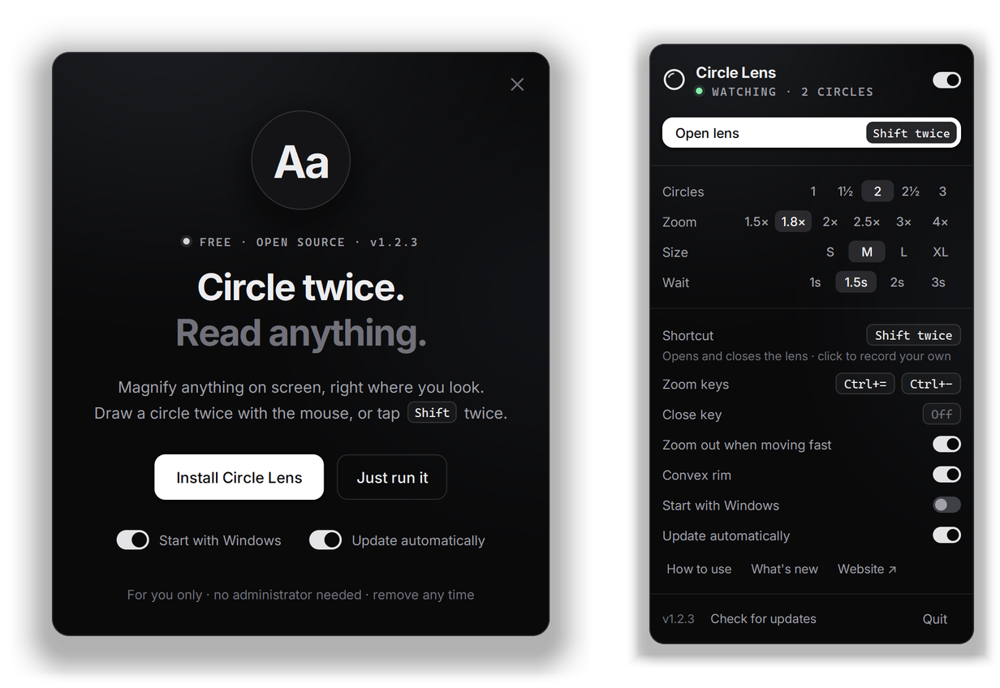
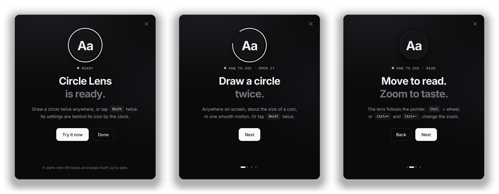

# The desktop app

Everything about the Windows app in detail: what's in a release, the tray panel and menu, shortcuts and keys, the command line, updates and diagnosing. For the macOS and Linux previews, see the [README](../README.md#macos-and-linux-preview).

<p align="center">
  
</p>

- [What a release contains](#what-a-release-contains)
- [The tray](#the-tray)
- [The shortcut and keys](#the-shortcut)
- [The lens itself](#the-lens-itself)
- [Command line](#command-line)
- [Updates](#updates)
- [Diagnosing](#diagnosing)

## What a release contains

`npm run package` builds all three and puts the files to hand out in `dist/`:

| File | What it is |
|---|---|
| `CircleLens-Setup-<version>.exe` | **The desktop app (Windows 10 2004 or later).** Run it from anywhere and its setup window offers to install it, for you only, with no administrator needed. You choose whether it starts with Windows and updates itself, and when it's done you can try it straight away. With a screen reader running, setup uses Windows' own dialogs instead, so it can be read. It goes into `%LOCALAPPDATA%\Programs\Circle Lens`, with a Start menu entry, Start with Windows, and an entry in Settings → Apps whose Uninstall removes it along with its settings. Running a newer one offers to update the installed copy and takes over from it while it runs. Choose *Just run it* to run it without installing; the tray menu can still install it later. Uninstalling from Settings → Apps uses the same window. Once installed, it **keeps itself up to date** from this repository's releases (see [Updates](#updates)). |
| `circle-lens-extension-<version>.zip` | **The browser extension**, in the form the Chrome Web Store, Edge Add-ons and Firefox Add-ons each take. |
| `circle-lens-<version>.min.js` | **The website script**, for sites that host it themselves. It is also on npm as [`circle-lens`](https://www.npmjs.com/package/circle-lens). |

For scripts, the exe also takes `-install` (install or update without asking) and `-uninstall -quiet`.

The exe isn't code-signed yet, so a downloaded copy gets Windows' "Windows protected your PC" screen the first time (More info → Run anyway). Signing it, with a certificate or through the Microsoft Store, removes that. Firefox only keeps unsigned extensions until restart; publishing through Firefox Add-ons signs it.

To build it yourself, run `npm run build:desktop`, which needs Go 1.22 or later and cross-compiles from any OS (the first build fetches `go-winres`, which embeds the app icon, version information and manifest).

## The tray

<p align="center">
  
</p>

- **Left click** opens a compact settings panel in the monochrome look of the project's website (near-black, soft neutral light, solid white buttons). It uses the best fonts your computer has (Inter, Geist and similar, else Segoe UI Variable), and bundles none. It has:
  - an on/off switch for Circle Lens: off, neither circles nor the shortcut open the lens;
  - an "Open lens" button showing your shortcut;
  - one-line pickers for circles, zoom, size, and the wait between open and close;
  - the shortcut, which you can click to record your own, and an on/off key (none by default);
  - the keys that work while the lens is open (zoom in, zoom out and close), each a keycap you can click to record another;
  - switches for zooming out when moving fast, the convex rim, starting with Windows, and updating automatically;
  - links to a short tour ("How to use"), this version's release notes ("What's new") and the website;
  - the version, with "Check for updates" beside it;
  - Quit.

  It works from the keyboard: Tab, the arrow keys, Enter or Space, and Esc.
- **Right click** opens the same settings as a native menu, which screen readers can read.
- **The icon** follows the taskbar's theme. While the lens is open, its glass fills in. It is dimmed and struck through while Circle Lens is off.

## The shortcut

**The shortcut** opens and closes the lens. It's **Shift twice** by default: tap Shift twice quickly, on its own, and capitals never count. The menus offer Ctrl twice, Ctrl+Alt+Z and Ctrl+Alt+L as presets, and you can record any combination or double tap from the panel or the menu.

- A combination is an ordinary Windows hotkey; if another app already has it, you're told and the old shortcut stays.
- A double tap needs a keyboard hook. It runs only while a double-tap shortcut is set and Circle Lens is on, or while you're recording one. It looks only at which keys go up and down, and keeps and logs nothing.
- While Circle Lens is off, the shortcut is let go: nothing opens the lens, not a circle, the shortcut, "Open the lens" in the menu, or `-toggle`.
- **The on/off key** turns Circle Lens on and off from anywhere. There's none until you record one (in the panel, or Shortcut → "Record an on/off key…" in the menu). It must be a key combination, not a double tap, and it stays claimed while Circle Lens is off, so it can turn it back on. Backspace while recording sets none.
- **Common shortcuts ask first.** Pick one that already does something everywhere (Ctrl+C, Alt+Tab, Win+L, F5, Ctrl twice for PowerToys' Find My Mouse…) as the shortcut or the on/off key, and you're asked whether to use it anyway: a combination is taken from every app while Circle Lens runs.

### Keys while the lens is open

- Zoom in and out are `Ctrl+=`/`Ctrl+−` by default (and the keypad's `+`/`−`), plus Ctrl + wheel.
- There's no close key unless you set one: Esc, or any combination you record. The shortcut always closes the lens too.
- Change them in the panel or under "Keys while the lens is open" in the menu.
- They're taken only while the lens is open and go back the moment it closes, so even plain Esc or a function key works.
- A key that types something (a letter, digit or punctuation) needs Ctrl, Alt or Win, so the lens never takes what you type.
- No two shortcuts can be the same, and one another app already has is refused.
- While recording the close key, Esc sets Esc and Backspace sets none.

## The lens itself

Two optional touches, both on by default:

- **Zoom out when moving fast.** Quick movement eases the zoom out, to half the zoom at full speed but never below 1×, and back in as you slow down. Scrolling under the lens does the same, in proportion to how fast it scrolls:

  | Lens | A notch every 400 ms | every 90 ms | every 30 ms |
  |---|---|---|---|
  | 4× | 4× | 3.4× | 2× |
  | 3× | 3× | 2.55× | 1.5× |
  | 1.8× | 1.8× | 1.56× | 1× |
- **Convex rim.** A thin band at the glass's edge eases the zoom off, like the rim of a real lens.

## Command line

```
circle-lens.exe            start; if a copy is already running, this one replaces it (so a new version takes over);
                           run from outside its install folder, it first offers to install
circle-lens.exe -install   install or update without asking
circle-lens.exe -uninstall uninstall (-quiet: without asking)
circle-lens.exe -open      start with the lens open
circle-lens.exe -toggle    open or close the lens of the running copy (bind it to a mouse button)
circle-lens.exe -quit      quit the running copy
```

Settings live in `%APPDATA%\CircleLens\settings.json`. If the app ever closes by itself, the reason is in `crash.log` beside them; attach it to a bug report.

## Updates

The installed app keeps itself up to date from this repository's [releases](https://github.com/fauzulkc/circle-lens/releases):

- **Automatically,** by default. It checks GitHub about once a day; the first check comes a minute and a half after it starts. A newer version is downloaded and checked: it must come from this repository's releases, match the size and SHA-256 digest GitHub publishes for it, and report the expected version. Anything else is deleted unrun. The update then waits until the lens is closed and the settings panel isn't open, swaps itself in within a second or two, and a notification says it's done; click it to see what's new.
- **On demand.** "Check for updates", beside the version in the panel or in the right-click menu, checks right away. If there's a newer version, it offers "Update to …".
- **Off.** Turn off "Update automatically" in the panel or menu, and the app never connects on its own. "Check for updates" still works when you want it.

Updates need the installed copy. A copy run straight from a download offers to install instead. Version 0.5.0 and earlier don't update themselves, so install 0.6.0 by hand once.

When a copy is already running, the new start asks it to quit and takes over. A copy running as administrator can't hear a copy that isn't, so for that case the new one asks once and closes it through Windows' permission prompt. Copies from 0.2.1 on accept these messages either way.

## Diagnosing

| Variable | What it does |
|---|---|
| `CIRCLE_LENS_LOG=<file>` | writes a diagnostic log: open-animation frame rate and longest gap, frames per second while shown, Go memory |
| `CIRCLE_LENS_FRAMES=<folder>` | saves the first 80 frames the lens (or flyout) draws as PNGs. The lens is left out of screen captures, so this is how to see it |
| `CIRCLE_LENS_PROFILE=<file>` | writes a CPU profile for `go tool pprof` |
| `CIRCLE_LENS_THEME=light` or `dark` | overrides the app theme |
| `CIRCLE_LENS_SHOW=flyout`, `menu`, `record` or `update` | opens one at start (`record` starts recording a shortcut, `update` presses "Check for updates"); several can be given, comma-separated |
| `CIRCLE_LENS_UPDATE_FEED`, `CIRCLE_LENS_UPDATE_DOWNLOADS`, `CIRCLE_LENS_UPDATE_DELAY` | **test builds only:** a stand-in for GitHub's latest-release address, the address prefix its downloads must have, and how soon after starting to check (`5s`). The real app always uses GitHub |
| `CIRCLE_LENS_EXCLUSION_TEST=1` | lets `go test -run TestCaptureExclusion ./cmd/circle-lens` show a window and report whether this Windows leaves the lens out of captures (the live lens needs it). The *Capture exclusion* workflow runs it on Windows Server 2022 and 2025 |
| `CIRCLE_LENS_NETWORK_TESTS=1` | lets `go test ./cmd/circle-lens` fetch and verify the real latest release |

A test build can run beside the copy in daily use: `-ldflags "-X main.instance=CircleLensTest"` gives it its own single-instance lock, window classes and settings folder.
